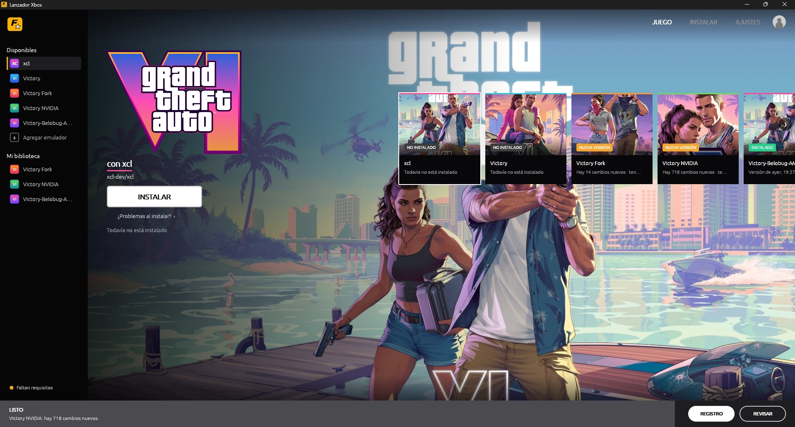
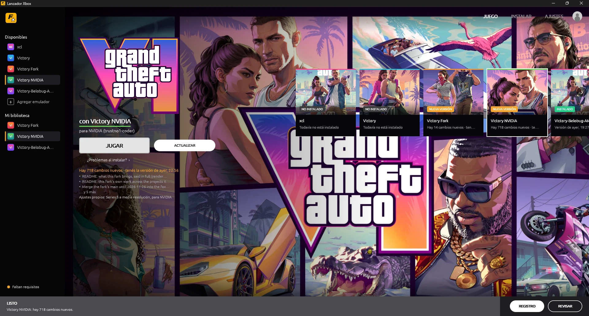
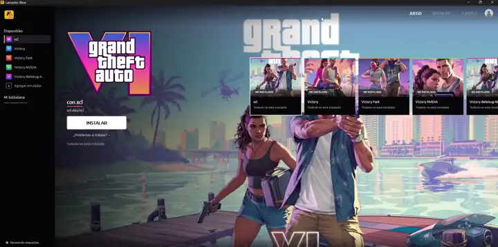

# Lanzador Xbox

A Windows launcher that installs, updates and runs Xbox Series emulators on PC:
[xcl](https://github.com/xcl-dev/xcl), [VIctory](https://github.com/Marvisak/VIctory),
[VIctory Fork](https://github.com/fxceless/victory-fork) and
[VIctory NVIDIA](https://github.com/trustno1-coder/VIctory-NVIDIA). You can also add
other forks of VIctory or xcl yourself.

**Install and run Xbox Series emulators in one click, with no manual compiling.** The launcher downloads, builds and updates them for you.

No game is included. You need your own copy.

The interface is available in **English, Spanish, Portuguese, French and Russian**. The
first time it uses your Windows language (or English if it is another one); you can change
it in **Settings** or on the initial setup screen.

## Screenshots

An emulator that is not installed yet, ready to install:



An installed emulator with an update available, ready to play:



## Demo

Picking an emulator in the launcher, pressing **JUGAR** and starting the game ([watch the full video](docs/demo.mp4), 57 s, no sound):

[](docs/demo.mp4)

## Download

Get the latest version from [Releases](../../releases/latest):

- **`LanzadorXbox-Setup-<version>.exe`** (recommended): installer. Creates Start menu and
  (optionally) desktop shortcuts, and can be uninstalled from Windows. No administrator
  rights needed.
- **`LanzadorXbox-v<version>.zip`**: portable. Unzip it and run `Lanzador-Xbox.exe`
  (keep the `imagenes` folder next to the `.exe`).

The program is not signed, so Windows may show **"Windows protected your PC"**. Click
**More info → Run anyway**.

### Antivirus warnings (false positives)

A few antivirus engines may flag the installer. This section explains exactly which ones,
why, and how you can check for yourself that the file is safe.

On [VirusTotal](https://www.virustotal.com/gui/file/0cb609fecdce19221604f1aa5082221344af10d39b1d068f78217f1ee25b2598),
`LanzadorXbox-Setup-0.2.0.exe` is flagged by **4 of 70** engines. The other 66, including
Microsoft Defender, Kaspersky, ESET, Bitdefender and Avast, detect nothing.

| Engine | What it is | Why it probably flags the file |
| --- | --- | --- |
| **DeepInstinct** | A deep-learning model that predicts whether an unknown file is malicious. | It does not look for a known virus: it scores how much the file *resembles* malware. It is known for flagging new, rare executables, and this one is both. The label it gave was `ObfuscatedPoly`, which means "looks like obfuscated code", not a named threat. |
| **SecureAge** | An AI/static engine (APEX) that decides from the file's structure, without running it. | Same idea: the installer carries a large block of compressed data, which this kind of model reads as "packed". It does not name any malware family. |
| **Skyhigh** | A reputation and heuristics engine (formerly McAfee Enterprise). | It distrusts files that few people have downloaded yet. It does not need to find anything bad inside; "unknown and unsigned" is enough for a generic detection. |
| **Arctic Wolf** | An engine from a managed security-monitoring service. | It uses a generic "unsafe" verdict based on file traits and reputation, again with no malware family named. |

None of the four names a real malware family (no trojan, stealer or ransomware name). All
four are generic, AI or reputation based verdicts, which are the ones that produce false
positives. That is also why the large, signature-based engines say nothing: there is no
known malware to match.

#### Why this file triggers them

- **The installer is compressed.** Inno Setup stores the launcher and its images
  compressed at the end of the `.exe` (the `overlay` tag on VirusTotal). To an automated
  scan, compressed data looks like obfuscated data, which is a trick malware uses to hide
  its code. Many legitimate installers get flagged for the same reason.
- **It is not code-signed.** A publisher certificate is what gives Windows and antivirus
  software a reason to trust a file. Certificates cost money every year, and this is a free
  hobby project, so it is unsigned. That is also why Windows shows "Windows protected your
  PC" (SmartScreen).
- **It is a new file with few downloads.** Reputation-based engines distrust anything
  nobody has seen before. Every new version is a new file with no history, so this
  repeats on each release and improves as more people download it.
- **What the launcher does looks like what malware does.** It downloads code from GitHub,
  runs other programs (`git`, `cargo`) and can stop a running emulator process. That is
  exactly what it needs to install, build and run the emulators, but a heuristic engine
  only sees "downloads and runs things" and cannot tell the difference.
- **It was written in Rust.** Rust executables are large and have unusual structure for
  scanners trained mostly on C/C++ and .NET files, and some malware is also written in
  Rust, so some models are cautious with it.

#### What the launcher does and does not do

- It talks only to GitHub (to download the emulators you choose) and to the tools it
  installs on your PC. It has no server of its own, no telemetry and no account.
- It does not collect or send any information about you or your computer.
- It stores its settings in `%LOCALAPPDATA%\XboxLanzador` and nowhere else.
- It does not start with Windows, does not hide itself and does not change system
  settings. The installer installs per user and needs no administrator rights.
- The full source code is in this repository: you can read every line.

#### How to check it yourself

1. **Build it from the source** (see [Building](#building)) and compare the behaviour. The
   code is the only thing that decides what the program does.
2. **Use the portable ZIP.** It contains the same `Lanzador-Xbox.exe` without the
   installer's compression, which removes the main reason for the warnings.
3. **Check the file you downloaded** against the SHA-256 of the current version
   (`0.3.0`), then scan it yourself on [VirusTotal](https://www.virustotal.com/) by
   uploading it or searching for the hash:

   ```
   LanzadorXbox-Setup-0.3.0.exe
   ddaed9f49fba434eaa409c847240667ef6617dfd829f53fce969e379278f6956

   LanzadorXbox-v0.3.0.zip
   37f05beee614bf86c0b6b1c2f005c6d9cac61f7e5658007c1b1c0dc93132c7b2
   ```

   In PowerShell: `Get-FileHash .\LanzadorXbox-Setup-0.3.0.exe`

   The VirusTotal report linked above is for version `0.2.0`; the numbers can differ for
   `0.3.0`, and they change over time as engines update.
4. **If you still don't trust it, don't run it.** Building from source is always an option.

If an engine flags a file, that is a reason to look, not proof. Here the look shows
generic AI and reputation verdicts on an unsigned, compressed, brand-new installer, and no
named malware.

## How to use it

1. Open `Lanzador-Xbox.exe`. The first time, the **initial setup** screen appears
   (*Configuración inicial*):
   - **Game folder**: if the launcher found it, it is already filled in; otherwise click
     the field and pick it. **CONTINUAR** (continue) is enabled once the folder contains
     the game.
   - **Emulators**: if you already have one downloaded, click its field and pick its
     folder (or **Usar esa** if the launcher found a copy). Otherwise leave it as is: the
     launcher downloads and builds it for you.
2. In **INSTALAR** (install), install whatever is missing to build (Rust, Visual Studio
   Build Tools, Windows SDK). The launcher checks this for you.
3. Pick an emulator on the left and click **INSTALAR**: it downloads it from GitHub and
   builds it.
4. Click **JUGAR** (play).

To go back to the initial setup: **Ajustes → Configuración inicial** (Settings → Initial
setup).

## Adding your own emulator

Click **+ Agregar emulador** (add emulator) in the left sidebar and fill in:

- **Name**: how it will appear in the launcher.
- **GitHub address**: for example `https://github.com/someone/victory-amd`.
- **Type**: whether it is based on **VIctory** or on **xcl**. The launcher builds and
  runs it the same way as the original it is based on, so it only works with forks of
  those two projects.
- **Branch** (optional): leave it empty to use the repository's default branch.

The launcher checks that the address exists before adding it. Then the emulator appears
in the sidebar like the others, and you can install, update and play it. To remove it:
**Ajustes → Dónde está cada emulador → Quitar** (this does not delete its files).

## What it finds by itself

- **The game folder**: it looks for the game executable (`*_master.exe`) in your personal
  folders (Desktop, Documents, Downloads…) and in `Games`, `Juegos` and `XboxGames` on
  every drive. If it cannot find it, pick it in **Ajustes → Cambiar carpeta**.
- **Emulators you already cloned**: it looks at the top-level folders of those same
  places (plus `source\repos`, `code`, `dev`, `projects`…) and recognizes each copy by
  the address of its `origin` remote. If it finds one, it offers **USAR ESA COPIA** (use
  that copy) instead of downloading it again. If your copy is somewhere else, pick it in
  **Ajustes → Dónde está cada emulador**.

When you don't use your own copy, the launcher keeps its own copies in
`%LOCALAPPDATA%\XboxLanzador\repos`. When updating one of your own copies, it merges the
new changes with yours; if they conflict, it tells you and leaves everything as it was.

To test without opening the window: `Lanzador-Xbox.exe --detect` shows what it finds
(also `--check`, `--prereq`, `--env` and `--install <id>`).

## Images

The `imagenes` folder (next to the `.exe`) holds the logo and the backgrounds. Without
images the launcher draws a sunset. To change them, replace those files or use
**Ajustes → Imágenes** (`%LOCALAPPDATA%\XboxLanzador\imagenes`, which takes priority):

- `logo.png`: the logo shown above the main button.
- The backgrounds, as `.jpg` or `.png`, with any name. Each emulator uses one, in order.

Changes show up the next time you open the launcher.

## VIctory NVIDIA settings

They are tuned for a 6 GB graphics card with little RAM (less memory for copies and
textures than the original `play-nvidia.ps1`). With a bigger card you can raise them by
editing `%LOCALAPPDATA%\XboxLanzador\config.json` (**Ajustes → Configuración**).

## Building

```
cargo build --release
```

The executable ends up in `target\release\xbox-lanzador.exe`. The icon (`icon\app.ico`)
is embedded in the `.exe` at build time; this needs the Windows SDK (without it the build
still works, just without the icon).

## Installer

The installer (`LanzadorXbox-Setup-<version>.exe`) is built with
[Inno Setup 6](https://jrsoftware.org/isinfo.php):

```
ISCC.exe installer\LanzadorXbox.iss
```

It ends up in `dist\`. It installs per user (no administrator rights), creates Start menu
shortcuts and, if chosen, a desktop shortcut, and can be uninstalled from Windows.

## Contributing

Bug reports, translations and pull requests are welcome. See [CONTRIBUTING.md](CONTRIBUTING.md) and the [Code of Conduct](CODE_OF_CONDUCT.md).

## License

[MIT](LICENSE). The emulators have their own licenses, in their repositories.
